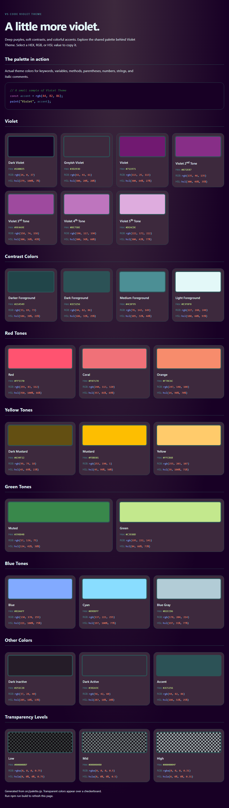

# Violet Theme

A violet-based dark theme for Visual Studio Code, pairing deep purple surfaces
with soft violet selections, cool teal accents, and colorful syntax highlighting.

## Color palette

[](palette.html)

[Explore the color palette](palette.html) in a dedicated page of small, rounded
color cards with names and selectable HEX, RGB, and HSL values.

## Highlights

- Deep violet editor background and muted purple sidebars.
- Coordinated editor tabs, lists, badges, and status bar.
- Colorful syntax highlighting, including nested JSON keys and Markdown.
- Modern UI styling with separate, rounded pill tabs.

## Activate the theme

1. Install **VioletTheme**.
2. Open **Preferences: Color Theme** (`Ctrl+K Ctrl+T` on Windows/Linux).
3. Select **VS Code Violet Theme**.

Requires VS Code **1.145.0 or newer**.

## Modern UI

The extension defaults Modern UI to enabled and editor tabs to `pill`.
These defaults apply while the extension is enabled, not only while this theme
is selected. Your explicit settings take precedence.

If needed, set:

```json
{
  "workbench.experimental.modernUI": true,
  "workbench.experimental.modernUIEditorTabStyle": "pill"
}
```

Connected tabs can use the editor surface color instead of the theme's custom
active-tab background.

## Unused-code styling

While this theme is selected, code reported as unnecessary by your language
extension appears italic with a muted foreground. This can include unused
variables, functions, imports, and unreachable code; the diagnostic determines
the highlighted range. `editor.showUnused` must be enabled.

Disable with `"violetTheme.decorateUnusedCode": false`.
Set the font style in Settings JSON (outside `workbench.colorCustomizations`):

```json
{
  "violetTheme.unusedFontStyle": "italic"
}
```

Supported styles are `italic` (default), `bold`, `underline`, and `strikethrough`
(also accepted as `line-through`),
combined with spaces, for example `"bold italic underline"`. `oblique` can replace
`italic`; `normal` or `""` adds no style. Changes apply
immediately, including when using opacity-only colors.
For squiggles, use `"italic underline wavy"`. Other underline modifiers are
`solid`, `dotted`, `dashed`, and `double`; place one immediately after `underline`.
When combined with strikethrough, the modifier affects both lines.
Append a decoration color, for example `"italic underline wavy #FF00FF"`.
Six- and eight-digit hex colors are supported without changing the text color.
Source defaults also refresh after a build while watching; explicit Settings
JSON values take precedence over source defaults.

Use `#000000AA` for opacity-only styling that preserves syntax colors (for
example, `#00000080` for approximately 50%). Other colors override the foreground.
The configured font style remains in either mode. This opacity can combine with VS Code's built-in
unused-code fading; set `editorUnnecessaryCode.opacity` to `#000000ff` in color
customizations if you want only the decoration's opacity applied.

Customize the color with:

```json
{
  "workbench.colorCustomizations": {
    "[VS Code Violet Theme]": {
      "violetTheme.unusedForeground": "#65737E"
    }
  }
}
```

## Development

For palette editing, automatic rebuilds, F5 preview, and local installation,
see the [development guide](DEVELOPMENT.md).
